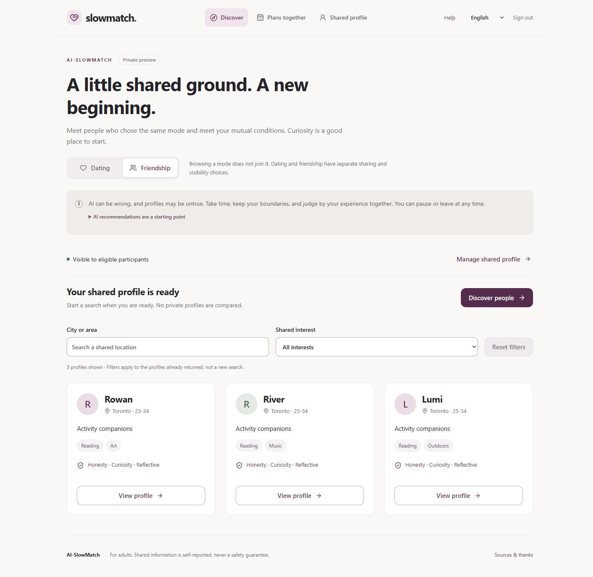
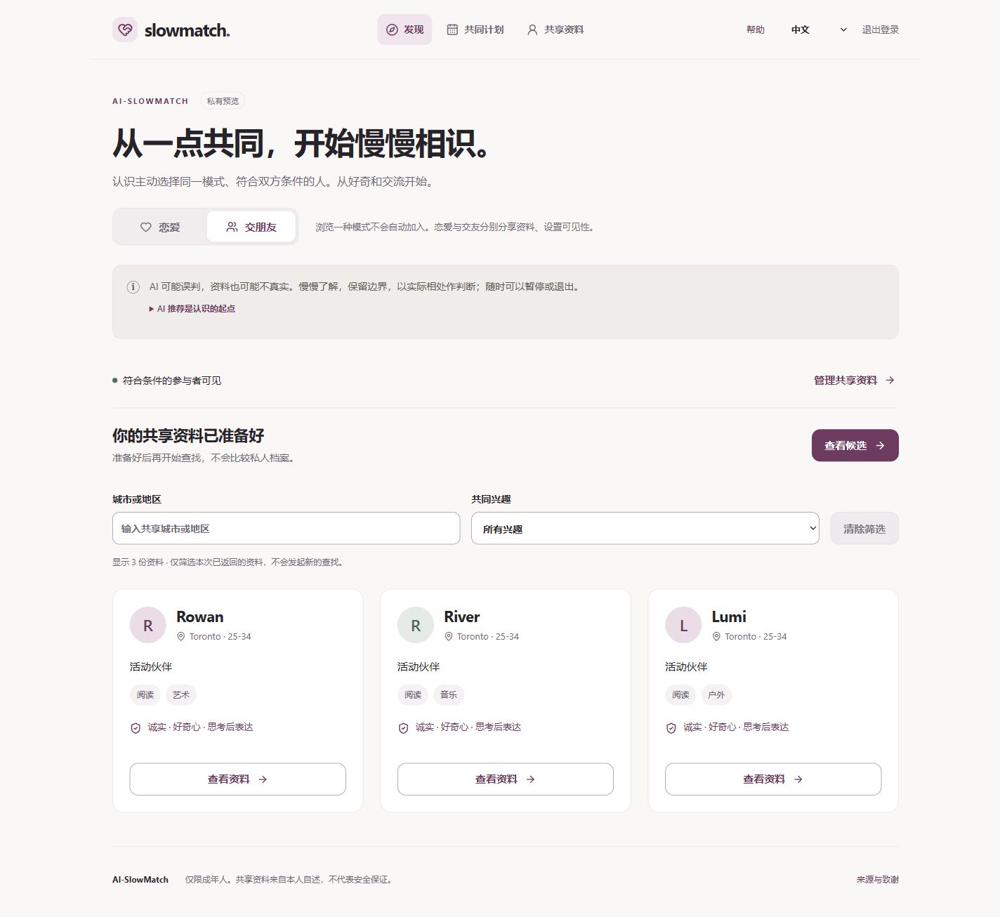

# AI-SlowMatch / 慢慢相识

[onepunchman26/Anti-Dating-App-Scam](https://github.com/onepunchman26/Anti-Dating-App-Scam)

**[Install with ChatGPT / 通过 ChatGPT 安装](INSTALL_WITH_CHATGPT.md)**

## English

The Site now has separate English/Chinese interfaces and clearer Discover, Plans together
and Shared profile pages. Language changes preserve in-progress choices without another
model or service request. [UI verification and limitations](docs/SITE_UI_VALIDATION.md)
distinguishes real local tests from independent-account acceptance. The following screenshot
uses synthetic local test profiles, not real members or a populated live service.

Understand your values, relationships and life direction through **your own ChatGPT
conversation**. Keep a correctable private profile on your computer, decide what to share,
explore dating or friendship separately, and get thoughtful help before, during or after
meeting someone. Your answers belong to you; there are no founder-default preferences,
public personality scores or guarantees about another person's honesty.

**v0.8.0 is the published controlled Windows x64 preview. There is no stable release yet.**
The [v0.8.0 Release](https://github.com/onepunchman26/Anti-Dating-App-Scam/releases/tag/v0.8.0)
contains the prebuilt component, source-commit mapping and checksums. The public-download
installer and repeat installation passed on the current Windows desktop; an independent
clean desktop remains untested. This is not a public ChatGPT plugin-directory listing.

### Start here

1. Give ChatGPT the exact project link above and ask it to follow
   [INSTALL_WITH_CHATGPT.md](INSTALL_WITH_CHATGPT.md). This installs the existing product;
   it should not audit the whole repository or rebuild your application.
2. Use Windows x64 with a ChatGPT desktop environment that permits local execution and
   plugin installation. The package includes its runtime: **no user-installed Python,
   Git, Node or compiler is required**. Automatic plugin registration separately requires
   the supported desktop `codex` installer to be available. Web-only chat cannot access
   your local profile; other operating systems are not verified.
3. Use the Release's [fixed-version Windows installer script](https://github.com/onepunchman26/Anti-Dating-App-Scam/releases/download/v0.8.0/install_work_preview.ps1).
   It downloads the exact package, verifies archive/manifest/component hashes, extracts only
   allowed files, installs and runs diagnostics. Run `./install_work_preview.ps1 -RegisterPlugin`
   to request official plugin registration too; without that flag it installs the local component only.
   It never changes execution policy or binds a user account. If script execution is restricted,
   report that platform condition rather than bypass it. The script pins the verified build's
   hashes; its [source](scripts/install_work_preview.ps1) is available for review.
   Complete your own platform login/permissions, run setup,
   then begin chatting. Everyone connects to the one maintained
   [matching service](https://slowmatch-private-pilot.fizzydeer7.chatgpt.site);
   ordinary users do not deploy a website or database.

A website opening successfully or a plugin being installed does not prove your account can
call the private Site. After the installed tools became available, the current existing Codex
desktop conversation read the setup Skill, made authenticated native reads and completed a
bound synthetic local write/read probe. A fresh ChatGPT setup conversation and the real
two-account flow remain unverified. See [validation and costs](docs/DISTRIBUTION_VALIDATION.md) and
[CURRENT_STATUS](CURRENT_STATUS.md) for actual results rather than assuming completion.

Offline installer checks, including extraction beyond 260 characters, passed in this
host's current PowerShell. Windows PowerShell 5.1 is execution-policy restricted on this
host, so its script compatibility remains unverified. No policy was changed or bypassed.

### What the preview implements

- Relationship support, self-understanding and practical next steps in ChatGPT; brief help
  during a meeting is available without recording or contacting anyone.
- A private profile you can review and correct, with sources, uncertainty and history.
  Daily work reads relevant topics and applies incremental changes.
- Separately approved dating and friendship summaries, visibility and withdrawal;
  reciprocal filtering and preliminary explanations use shared information only.
- Private candidate reflection using your own authorized profile and the peer's shared
  summary. It never assumes access to the peer's private thoughts or full profile.
- Voluntary activity preferences, two or three proposed options, separate participant
  confirmations and optional private reflection. A plan does not book, pay, invite outside
  the Site, share live location or modify a calendar.
- Selected text/WAV import and user-supplied or corrected transcripts. The portable preview
  does **not** include automatic transcription or microphone recording.

These are implemented capabilities, not a claim that every deployment/account path has
passed. [Controlled synthetic A/B instructions](CONTROLLED_TEST.md) cover the remaining
product acceptance without using anyone's real private information.

### Your information

Full profiles, private reports, relationship observations, raw material and private filtering
reasons stay in your local workflow. The Windows package separates account-bound data under
`%LOCALAPPDATA%/AI-SlowMatch/accounts/` from replaceable program/plugin files and OneDrive.
Local files are currently plaintext. Same-Windows-user slots prevent accidental account
mixing; separate OS users/devices provide a stronger boundary.

ChatGPT may process the information you authorize under your OpenAI settings. That is
separate from permission to send it to Sites. The service accepts only exact-version,
purpose-bound approved summaries and minimal shared activity/feedback objects—not raw chats,
audio, transcripts, private analyses or complete profiles. Updating your profile does not
publish it. Personal relationship help never requires the other person's permission.

### Original project, help and credits

This is a migration of the original repository, reusing its Python models, storage and
services. ChatGPT is the primary conversation entry. The existing **0.5.3 `AI-SlowMatch.exe`**
remains the historical recovery application; it is not the new **`SlowMatch-Work.exe`**
component and has not been represented as a rebuilt 0.8 desktop app.

[Installation/update/uninstall help](docs/DISTRIBUTION_HELP.md) ·
[Current evidence](CURRENT_STATUS.md) · [Progress](PROGRESS_TRACKER.md) ·
[Product plan](PLAN_FOR_ONEPUCHMAN.md) · [Maintainer deployment](apps/matching_site/README.md) ·
[Legacy build/recovery](packaging/README.md)

Thank you to the Sites/Vinext starter and retained build/CSS components, Python and its
runtime dependencies, goutoujunshi's bounded coaching ideas, and the documented design
references. Actual bundled code, external tools and method references are distinguished in
[credits and notices](docs/39_open_source_credits.md). **No project-wide license has yet
been selected**; third-party MIT/Apache notices do not license the whole application.
See [licensing status and options](docs/LICENSING_STATUS.md).

## 中文版

网站已实现完整中文／英文切换，并整理为“发现、共同计划、共享资料”。切换语言保留进行中的
选择，不增加模型或服务请求。[界面验收与限制](docs/SITE_UI_VALIDATION.md)区分真实本机测试
与独立账号验收。下图使用本机合成测试资料，不是真实成员，也不代表线上已有候选。

通过**你自己的 ChatGPT 对话**理解价值观、关系与人生方向。在自己的电脑上保留可纠正的私人档案，
自主决定分享什么，分别探索恋爱或友谊，并在见面前、中途或之后获得具体帮助。每个人的答案以本人为准，
不套用创始人偏好、不设公开人格分，也不保证他人诚实。

**v0.8.0 是已发布的 Windows x64 受控预览，目前没有稳定版。**
[v0.8.0 发布页](https://github.com/onepunchman26/Anti-Dating-App-Scam/releases/tag/v0.8.0)
已提供预编译组件、源码提交对应关系和校验值。公开下载的安装脚本及重复安装已在当前 Windows
桌面通过；独立干净桌面尚未实测，也未上架 ChatGPT 公共插件目录。

### 从这里开始

1. 把页首准确项目链接交给 ChatGPT，请它遵照 [INSTALL_WITH_CHATGPT.md](INSTALL_WITH_CHATGPT.md)。
   这是安装现有产品，不应要求全库审计或重新开发应用。
2. 使用允许本机执行和插件安装的 Windows x64 ChatGPT 桌面环境。发布包自带运行组件，
   **普通用户无需另装 Python、Git、Node 或编译器**。自动插件登记另需桌面环境能够调用受支持的
   `codex` 安装器。纯网页聊天不能访问本机档案；其他操作系统尚未验证。
3. 使用 Release 中的[固定版本 Windows 安装脚本](https://github.com/onepunchman26/Anti-Dating-App-Scam/releases/download/v0.8.0/install_work_preview.ps1)。
   它下载指定包、验证压缩包／清单／组件哈希，仅解压允许文件，然后安装并诊断。
   运行 `./install_work_preview.ps1 -RegisterPlugin` 可同时请求官方插件登记；不带该参数则只安装本机组件。
   它不改变执行策略、不绑定用户账号。脚本执行受限时准确报告平台条件，不绕过。
   脚本已固定核实构建的哈希；可先查看[源码](scripts/install_work_preview.ps1)。
   完成本人平台登录／权限和设置检查，然后开始聊天。所有人连接统一维护的
   [匹配服务](https://slowmatch-private-pilot.fizzydeer7.chatgpt.site)，普通用户不部署网站或数据库。

网站能打开或插件已安装，不证明本人账号能调用私有 Site。安装工具变为可用后，当前已有 Codex 桌面
会话已读取 setup Skill、完成本人认证的原生读取和绑定账号的合成本机写读探针；新 ChatGPT 设置会话
及真实独立双账号流程仍未验证。实际结果见[验证与成本](docs/DISTRIBUTION_VALIDATION.md)
和 [CURRENT_STATUS](CURRENT_STATUS.md)，不能据功能描述推断全部通过。

本机当前 PowerShell 的安装器离线检查已通过，包括超过 260 字符的路径提取。此机器的 Windows
PowerShell 5.1 受执行策略限制，因此尚未验证其脚本兼容性；没有修改或绕过策略。

### 预览已实现的能力

- 在 ChatGPT 中获得关系支持、自我理解及可执行的下一步；见面中途也可简短求助，不会顺带录音或联系别人。
- 可审阅、纠正的私人档案，记录来源、不确定性和历史；日常按相关主题读取并增量更新。
- 分别批准恋爱／朋友摘要、可见性和撤回；双向筛选与初步解释只使用共享资料。
- 用本人获准档案和对方共享摘要进行私人候选复盘，不假装知道对方的内心或完整档案。
- 自愿分享活动偏好，比较两三个方案，由各参与者独立确认，并按需私人复盘。方案不自动预订、付款、
  发送站外邀请、共享实时位置或修改日历。
- 选定文字／WAV 导入及本人提供或纠正的转写。便携预览**不包含自动转写或麦克风录音**。

这些是已实现能力，不代表每个部署／账号通道都通过验收。[合成双账号测试指南](CONTROLLED_TEST.md)
覆盖剩余产品验收，不使用任何人的真实私密资料。

### 你的资料

完整档案、私人报告、关系观察、原始材料及私人筛选原因留在本机工作流。Windows 包把账号绑定资料放在
`%LOCALAPPDATA%/AI-SlowMatch/accounts/`，与可替换程序／插件和 OneDrive 分开。当前本机文件为明文。
同一 Windows 用户的分槽防误混；不同系统用户／设备提供更强隔离。

ChatGPT 可按你的 OpenAI 设置处理本人授权的信息；这不等于允许上传 Sites。网站只接收绑定具体版本、
用途且经过批准的摘要，以及最少共同活动／反馈对象，不接收原始聊天、录音、转写、私人分析或完整档案。
更新档案不会自动发布。私人关系求助从不要求先取得对方许可。

### 原项目、帮助与致谢

本次继续迁移原仓库，复用 Python 结构、存储及服务，以 ChatGPT 为主要对话入口。原有
**0.5.3 `AI-SlowMatch.exe`** 保留为历史恢复应用；它与新的 **`SlowMatch-Work.exe`** 组件不同，
没有被宣称为重建的 0.8 桌面应用。

[安装／更新／卸载帮助](docs/DISTRIBUTION_HELP.md) · [当前依据](CURRENT_STATUS.md) ·
[进度](PROGRESS_TRACKER.md) · [产品计划](PLAN_FOR_ONEPUCHMAN.md) ·
[维护者部署](apps/matching_site/README.md) · [旧版构建／恢复](packaging/README.md)

感谢 Sites／Vinext 模板及保留的构建／CSS 组件、Python 与运行依赖、goutoujunshi 的边界明确的辅导
方法，以及已记录的设计参考。[署名与许可记录](docs/39_open_source_credits.md)区分实际打包代码、
外部工具和方法借鉴。**项目整体许可尚未选定**；第三方的 MIT／Apache 通知不代表整个应用采用这些许可。
见[许可状态与选项](docs/LICENSING_STATUS.md)。

## Actual service check / 实际服务检查

Actual owner-authenticated browser check: service 0.8.0, protocol 1.0, controlled test scope,
database read passed, no profile published. Native desktop/local access and independent A/B
acceptance are not established by this screenshot.

实际所有者认证浏览器检查：服务 0.8.0、协议 1.0、受控测试范围，数据库读取通过，未发布档案。
此截图不证明原生桌面／本机访问或独立 A/B 验收通过。
