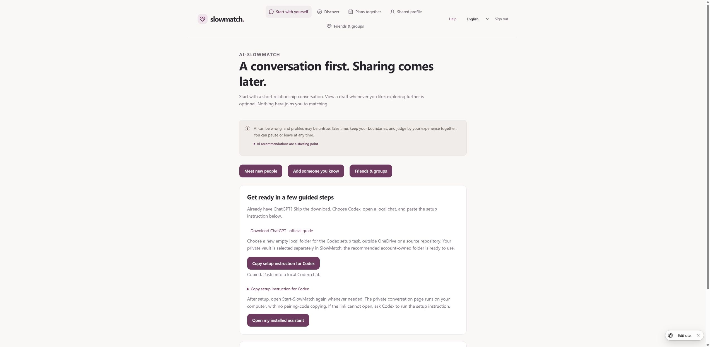
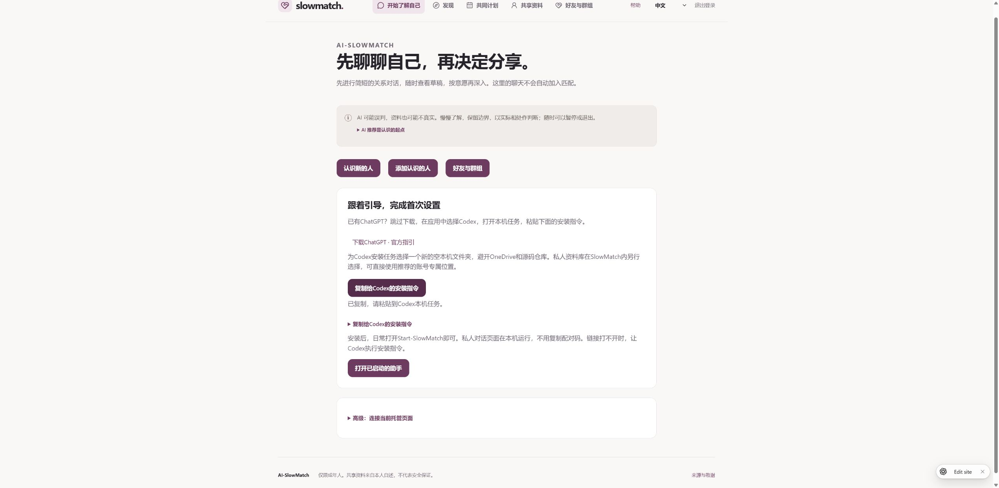
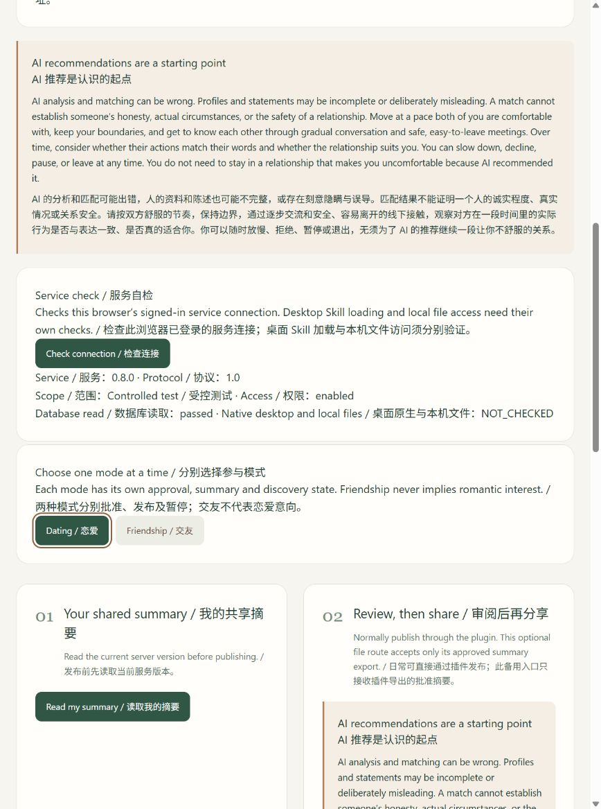

0.8.6 voice preview / 0.8.6语音预览：[Voice guide / 语音说明](VOICE.md).

English: adds local dictation, editable text drafts and explicitly enabled turn-based send/read. ChatGPT still handles conversation. Audio stays on this computer. Physical microphone and complete spoken-turn acceptance remain pending; see CURRENT_STATUS.

中文：新增本机听写、可编辑文字草稿及明确开启的逐轮发送／朗读。ChatGPT仍负责对话，音频保留在本机。实体麦克风及完整语音回合仍待验收，详见CURRENT_STATUS。

Product purpose and retained capabilities / 产品用途与保留能力：[Continuity map / 连续性对照](PRODUCT_CONTINUITY.md).

0.8.5 continuity update: the web assistant now connects the original relationship-support and private-reflection services. Prepare a meeting, ask for help, review an interaction, or explore next steps. [Private reflections](PRIVATE_REFLECTION.md) can be edited, saved locally, corrected and reused with separate consent. [Copy the Codex setup instruction](SETUP_WITH_CODEX.md). Independent-account acceptance remains untested.

0.8.5核心连续性更新：网页助手已接入原关系支持与私人复盘服务，可准备见面、主动求助、梳理相处或讨论人生下一步。[私人复盘](PRIVATE_REFLECTION.md)可编辑、本机保存、纠正，并经另行同意用于后续讨论。[复制Codex安装指令](SETUP_WITH_CODEX.md)。独立账号验收仍未实测。

# AI-SlowMatch / 慢慢相识

[onepunchman26/Anti-Dating-App-Scam](https://github.com/onepunchman26/Anti-Dating-App-Scam)

**[Start here / 从这里开始](SETUP_WITH_CODEX.md)** · [Native ChatGPT plugin / 原生插件](INSTALL_WITH_CHATGPT.md)

## English

[Friends and private groups](FRIENDS_GROUPS.md) add stable IDs, mutual requests and individually approved 2–8-person activities. Invitees can participate without the local assistant. Only a willing AI executor needs it; shared generation never reads private profiles.

The **0.8.6 controlled Windows preview** adds a guided web conversation to the existing
project. Start with self-understanding, keep dedicated sessions and confirmed statements
on your computer, then separately review what to share for dating or friendship.
Your answers are your own; there are no founder-default preferences or personality scores.

The [private Site](https://slowmatch-private-pilot.fizzydeer7.chatgpt.site) now includes
**Start with yourself**, complete English/Chinese selection, shared-profile forms and
reciprocal city choices. [Actual evidence and remaining gates](docs/EASY_SETUP_DISCOVERY_VALIDATION.md).
The screenshot shows the deployed private setup page, with no private conversation or member data.

### Start here

1. Open the [short Codex setup guide](SETUP_WITH_CODEX.md). Existing ChatGPT/Codex users
   can copy its prompt directly; others use its official desktop download link.
2. Codex installs the pinned **0.8.6** Windows preview and opens the local page. Use
   `Start-SlowMatch.cmd` next time; no manual pairing code is needed on this route.
3. Connect existing official authorization, confirm plan use and your private folder,
   then chat. AI can draft broad shared tags from the selected conversation; review
   them before exporting and separately publishing.
4. Discover by coarse city/area, age and interests. Reciprocal rules run on the server
   before the result limit. Private AI review can compare approved candidate summaries
   with your own selected confirmed statements; results stay local.

Current-owner Chrome connection, a real AI interview reply, AI summary drafting and
private candidate review have passed with synthetic material. The direct hosted-to-local
request still times out in this environment; the supported daily fallback opens the same
conversation components locally. Independent B/C accounts, fresh-account installation,
broad runtime eligibility and public-catalog listing remain unverified. The Site remains
owner-private. City filtering is not GPS/radius search; AI reasoning is not a verified
personality test or proof of honesty. See [CURRENT_STATUS](CURRENT_STATUS.md).

### What the preview implements

- Relationship support, self-understanding and practical next steps in ChatGPT; brief help
  during a meeting is available without recording or contacting anyone.
- A private profile you can review and correct, with sources, uncertainty and history.
  Daily work reads relevant topics and applies incremental changes.
- Separately approved dating and friendship summaries, visibility and withdrawal;
  reciprocal filtering and preliminary explanations use shared information only.
- Private candidate reflection using your own authorized profile and the peer's shared
  summary. It never assumes access to the peer's private thoughts or full profile.
- Voluntary activity preferences, two or three proposed options, separate participant
  confirmations and optional private reflection. A plan does not book, pay, invite outside
  the Site, share live location or modify a calendar.
- Selected text/WAV handling and optional local dictation (up to 30 seconds), with an editable draft.
  Opt-in turn-based voice sends recognized text to ChatGPT and uses device-local reply reading.
  Model download, microphone, recognition, playback and full spoken turns are separate checks.
  See the [voice guide](VOICE.md); full-duplex cloud voice is not supported by this plan route.

These are implemented capabilities, not a claim that every deployment/account path has
passed. [Controlled synthetic A/B instructions](CONTROLLED_TEST.md) cover the remaining
product acceptance without using anyone's real private information.

### Your information

Full profiles, private reports, relationship observations, raw material and private filtering
reasons stay in your local workflow. The Windows package separates account-bound data under
`%LOCALAPPDATA%/AI-SlowMatch/accounts/` from replaceable program/plugin files and OneDrive.
Local files are currently plaintext. Same-Windows-user slots prevent accidental account
mixing; separate OS users/devices provide a stronger boundary.

ChatGPT may process the information you authorize under your OpenAI settings. That is
separate from permission to send it to Sites. The service accepts only exact-version,
purpose-bound approved summaries and minimal shared activity/feedback objects—not raw chats,
audio, transcripts, private analyses or complete profiles. Updating your profile does not
publish it. Personal relationship help never requires the other person's permission.

### Original project, help and credits

This is a migration of the original repository, reusing its Python models, storage and
services. ChatGPT is the primary conversation entry. The existing **0.5.3 `AI-SlowMatch.exe`**
remains the historical recovery application; it is not the new **`SlowMatch-Work.exe`**
component and has not been represented as a rebuilt 0.8 desktop app.

[Installation/update/uninstall help](docs/DISTRIBUTION_HELP.md) ·
[Current evidence](CURRENT_STATUS.md) · [Progress](PROGRESS_TRACKER.md) ·
[Product plan](PLAN_FOR_ONEPUCHMAN.md) · [Maintainer deployment](apps/matching_site/README.md) ·
[Legacy build/recovery](packaging/README.md)

Thank you to the Sites/Vinext starter and retained build/CSS components, Python and its
runtime dependencies, goutoujunshi's bounded coaching ideas, and the documented design
references. Actual bundled code, external tools and method references are distinguished in
[credits and notices](docs/39_open_source_credits.md). **No project-wide license has yet
been selected**; third-party MIT/Apache notices do not license the whole application.
See [licensing status and options](docs/LICENSING_STATUS.md).

## 中文版

[好友与私人群组](FRIENDS_GROUPS.md)增加稳定 ID、双向申请和逐人批准的2–8人活动。受邀者无需本机助手即可参与；仅自愿运行 AI 的成员需要助手，共同生成不读取私人档案。

**0.8.6 Windows 受控预览**在原项目中加入了网页对话引导。先认识自己，将专用会话和
本人确认的陈述保存在电脑，再单独审阅恋爱或朋友匹配要分享的内容。
每个人的答案以本人为准，不套用创始人偏好，也不设人格评分。

[私有网站](https://slowmatch-private-pilot.fizzydeer7.chatgpt.site)现有“开始了解自己”、
完整中英文切换、共享摘要表单与双方城市选择。见[实际证据和未完成项](docs/EASY_SETUP_DISCOVERY_VALIDATION.md)。
下图为已部署的私有网站安装页，不含私人对话或成员资料。

### 从这里开始

1. 打开[简短 Codex 设置指引](SETUP_WITH_CODEX.md)。已有 ChatGPT／Codex 可直接复制其中的
   安装指令；没有则使用指引里的官方客户端下载链接。
2. Codex 安装固定 **0.8.6** Windows 预览版并打开本机页面。以后使用 `Start-SlowMatch.cmd`，
   这条路线不需要手动复制配对码。
3. 连接现有官方授权，确认套餐使用和私人文件夹后开始聊天。AI可从所选对话起草宽泛共享标签，
   逐项审阅后才导出，发布仍是独立操作。
4. 在发现页面选择粗略城市／地区、年龄和兴趣，服务端在结果截断前检查双方条件。私人AI分析
   可比较对方获准摘要与本人选择的已确认陈述，结果只留本机。

当前账号的Chrome连接、真实AI访谈回复、AI摘要草稿及私人候选分析均已用合成材料跑通。
此环境的托管网页直接连接本机仍会超时，日常替代入口在本机打开同一套对话组件。独立B／C账号、
新账号安装、广泛接入资格和公共目录上架仍未验证，网站仍为所有者私有测试。城市筛选不是GPS或
半径搜索，AI解释不是经验证的人格测评，也不证明对方诚实。详见[当前交接](CURRENT_STATUS.md)。

### 预览已实现的能力

- 在 ChatGPT 中获得关系支持、自我理解及可执行的下一步；见面中途也可简短求助，不会顺带录音或联系别人。
- 可审阅、纠正的私人档案，记录来源、不确定性和历史；日常按相关主题读取并增量更新。
- 分别批准恋爱／朋友摘要、可见性和撤回；双向筛选与初步解释只使用共享资料。
- 用本人获准档案和对方共享摘要进行私人候选复盘，不假装知道对方的内心或完整档案。
- 自愿分享活动偏好，比较两三个方案，由各参与者独立确认，并按需私人复盘。方案不自动预订、付款、
  发送站外邀请、共享实时位置或修改日历。
- 选定文字／WAV处理及可选本机听写（最长30秒），结果先进入可编辑草稿。明确开启逐轮语音后，
  将识别文字发给ChatGPT并由本机朗读。模型下载、麦克风、识别、朗读和完整语音回合分别验收；
  见[语音说明](VOICE.md)，当前套餐接入不支持实时双向云端语音。

这些是已实现能力，不代表每个部署／账号通道都通过验收。[合成双账号测试指南](CONTROLLED_TEST.md)
覆盖剩余产品验收，不使用任何人的真实私密资料。

### 你的资料

完整档案、私人报告、关系观察、原始材料及私人筛选原因留在本机工作流。Windows 包把账号绑定资料放在
`%LOCALAPPDATA%/AI-SlowMatch/accounts/`，与可替换程序／插件和 OneDrive 分开。当前本机文件为明文。
同一 Windows 用户的分槽防误混；不同系统用户／设备提供更强隔离。

ChatGPT 可按你的 OpenAI 设置处理本人授权的信息；这不等于允许上传 Sites。网站只接收绑定具体版本、
用途且经过批准的摘要，以及最少共同活动／反馈对象，不接收原始聊天、录音、转写、私人分析或完整档案。
更新档案不会自动发布。私人关系求助从不要求先取得对方许可。

### 原项目、帮助与致谢

本次继续迁移原仓库，复用 Python 结构、存储及服务；网页助手与原生插件共用核心。原有
**0.5.3 `AI-SlowMatch.exe`** 保留为历史恢复应用；它与新的 **`SlowMatch-Work.exe`** 组件不同，
没有被宣称为重建的 0.8 桌面应用。

[安装／更新／卸载帮助](docs/DISTRIBUTION_HELP.md) · [当前依据](CURRENT_STATUS.md) ·
[进度](PROGRESS_TRACKER.md) · [产品计划](PLAN_FOR_ONEPUCHMAN.md) ·
[维护者部署](apps/matching_site/README.md) · [旧版构建／恢复](packaging/README.md)

感谢 Sites／Vinext 模板及保留的构建／CSS 组件、Python 与运行依赖、goutoujunshi 的边界明确的辅导
方法，以及已记录的设计参考。[署名与许可记录](docs/39_open_source_credits.md)区分实际打包代码、
外部工具和方法借鉴。**项目整体许可尚未选定**；第三方的 MIT／Apache 通知不代表整个应用采用这些许可。
见[许可状态与选项](docs/LICENSING_STATUS.md)。

## Actual service check / 实际服务检查

Actual owner-authenticated browser check: service 0.8.0, protocol 1.0, controlled test scope,
database read passed, no profile published. Native desktop/local access and independent A/B
acceptance are not established by this screenshot.

实际所有者认证浏览器检查：服务 0.8.0、协议 1.0、受控测试范围，数据库读取通过，未发布档案。
此截图不证明原生桌面／本机访问或独立 A/B 验收通过。
