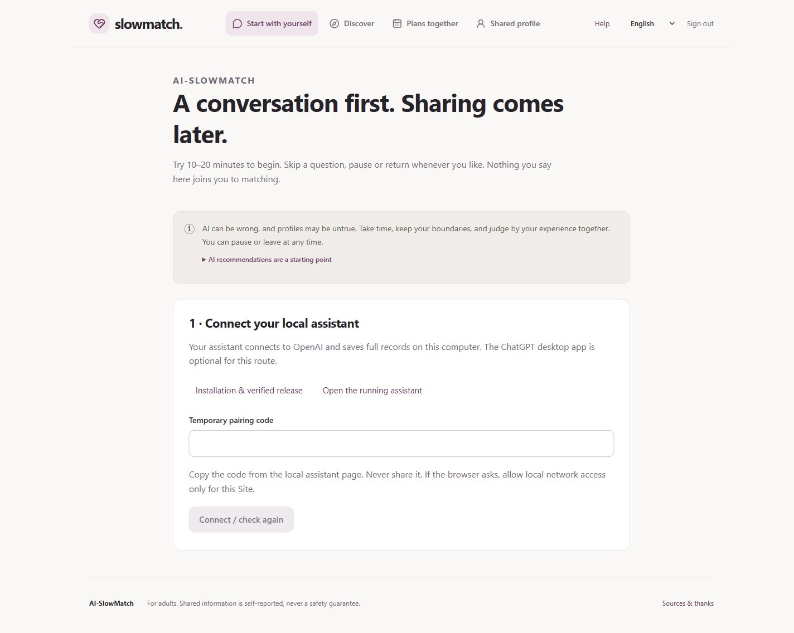
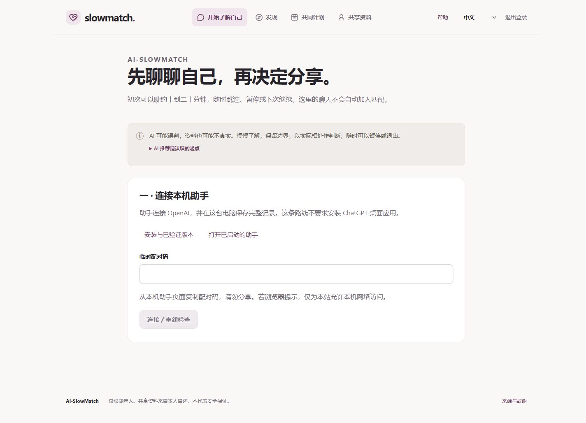

# AI-SlowMatch / 慢慢相识

[onepunchman26/Anti-Dating-App-Scam](https://github.com/onepunchman26/Anti-Dating-App-Scam)

**[Start here / 从这里开始](WEB_COMPANION.md)** · [Native ChatGPT plugin / 原生插件](INSTALL_WITH_CHATGPT.md)

## English

The **0.8.1 controlled Windows preview** adds a guided web conversation to the existing
project. Start with self-understanding, keep dedicated sessions and confirmed statements
on your computer, then separately review what to share for dating or friendship.
Your answers are your own; there are no founder-default preferences or personality scores.

The [private Site](https://slowmatch-private-pilot.fizzydeer7.chatgpt.site) now includes
**Start with yourself**, complete English/Chinese selection, shared-profile forms and
reciprocal city choices. [Actual evidence and remaining gates](docs/WEB_COMPANION_VALIDATION.md).
The screenshot is the real local QA page, with no private conversation or real member data.

### Start here

1. Open the [short Windows guide](WEB_COMPANION.md) and its pinned **0.8.1** release.
   Extract the entire ZIP and open **Start-SlowMatch.cmd**. No Python, Node, compiler,
   developer checkout or separate server is needed. Keep the helper window open.
2. Pair the webpage with the local helper, finish official ChatGPT authorization,
   check plan/model access, and explicitly choose or reconnect your private folder.
   ChatGPT desktop is optional for this web route. Do not enable extra credits for testing.
3. Begin a dedicated conversation, review your own statements, and only then choose
   a separate summary to publish. Nothing in the private conversation is auto-published.
   [The native plugin](INSTALL_WITH_CHATGPT.md) remains an alternative.

Current-owner real inference, local-browser chat, packaged-helper restart and 29 isolated
installation/repair calls passed. **The hosted browser currently requires the owner's
login; HTTPS-to-loopback browser acceptance is still open.** Independent account B,
fresh-account installation, and broad eligibility of the hosted-UI/local-SIWC combination
remain unverified. No stable release, public plugin-directory listing or universal setup
success is claimed. The project-wide license remains undeclared. See
[CURRENT_STATUS](CURRENT_STATUS.md) for the latest release and download evidence.

### What the preview implements

- Relationship support, self-understanding and practical next steps in ChatGPT; brief help
  during a meeting is available without recording or contacting anyone.
- A private profile you can review and correct, with sources, uncertainty and history.
  Daily work reads relevant topics and applies incremental changes.
- Separately approved dating and friendship summaries, visibility and withdrawal;
  reciprocal filtering and preliminary explanations use shared information only.
- Private candidate reflection using your own authorized profile and the peer's shared
  summary. It never assumes access to the peer's private thoughts or full profile.
- Voluntary activity preferences, two or three proposed options, separate participant
  confirmations and optional private reflection. A plan does not book, pay, invite outside
  the Site, share live location or modify a calendar.
- Selected text/WAV import and user-supplied or corrected transcripts. The portable preview
  does **not** include automatic transcription or microphone recording.

These are implemented capabilities, not a claim that every deployment/account path has
passed. [Controlled synthetic A/B instructions](CONTROLLED_TEST.md) cover the remaining
product acceptance without using anyone's real private information.

### Your information

Full profiles, private reports, relationship observations, raw material and private filtering
reasons stay in your local workflow. The Windows package separates account-bound data under
`%LOCALAPPDATA%/AI-SlowMatch/accounts/` from replaceable program/plugin files and OneDrive.
Local files are currently plaintext. Same-Windows-user slots prevent accidental account
mixing; separate OS users/devices provide a stronger boundary.

ChatGPT may process the information you authorize under your OpenAI settings. That is
separate from permission to send it to Sites. The service accepts only exact-version,
purpose-bound approved summaries and minimal shared activity/feedback objects—not raw chats,
audio, transcripts, private analyses or complete profiles. Updating your profile does not
publish it. Personal relationship help never requires the other person's permission.

### Original project, help and credits

This is a migration of the original repository, reusing its Python models, storage and
services. ChatGPT is the primary conversation entry. The existing **0.5.3 `AI-SlowMatch.exe`**
remains the historical recovery application; it is not the new **`SlowMatch-Work.exe`**
component and has not been represented as a rebuilt 0.8 desktop app.

[Installation/update/uninstall help](docs/DISTRIBUTION_HELP.md) ·
[Current evidence](CURRENT_STATUS.md) · [Progress](PROGRESS_TRACKER.md) ·
[Product plan](PLAN_FOR_ONEPUCHMAN.md) · [Maintainer deployment](apps/matching_site/README.md) ·
[Legacy build/recovery](packaging/README.md)

Thank you to the Sites/Vinext starter and retained build/CSS components, Python and its
runtime dependencies, goutoujunshi's bounded coaching ideas, and the documented design
references. Actual bundled code, external tools and method references are distinguished in
[credits and notices](docs/39_open_source_credits.md). **No project-wide license has yet
been selected**; third-party MIT/Apache notices do not license the whole application.
See [licensing status and options](docs/LICENSING_STATUS.md).

## 中文版

**0.8.1 Windows 受控预览**在原项目中加入了网页对话引导。先认识自己，将专用会话和
本人确认的陈述保存在电脑，再单独审阅恋爱或朋友匹配要分享的内容。
每个人的答案以本人为准，不套用创始人偏好，也不设人格评分。

[私有网站](https://slowmatch-private-pilot.fizzydeer7.chatgpt.site)现有“开始了解自己”、
完整中英文切换、共享摘要表单与双方城市选择。见[实际证据和未完成项](docs/WEB_COMPANION_VALIDATION.md)。
下图为真实本机验证页面，不含私人对话或真实成员资料。

### 从这里开始

1. 打开[Windows 短指引](WEB_COMPANION.md)，使用其中固定的 **0.8.1** 版本。
   解压整个 ZIP，打开 **Start-SlowMatch.cmd**，使用时保持助手窗口开启。
   不要求 Python、Node、编译器、开发者源码环境或另建服务器。
2. 将网页与本机助手配对，完成官方 ChatGPT 授权，检查套餐和模型权限，
   明确选择或重连私人文件夹。网页路线不要求 ChatGPT 桌面应用；测试不要开启额外点数。
3. 开始专用会话、审阅本人陈述，再单独选择发布摘要；私人聊天不会自动发布。
   [原生插件](INSTALL_WITH_CHATGPT.md)仍可作为替代入口。

当前维护者的真实推理、本机浏览器聊天、打包助手重启和 29 项独立安装／修复调用通过。
**托管网站的浏览器当前需要本人登录，HTTPS 网页到本机助手的浏览器验收尚未完成。**
独立 B 账号、全新账号安装，以及“托管网页＋本机 SIWC”组合的广泛发行资格仍未验证。
不宣称稳定版、公共插件目录上架或所有用户均可完成设置；项目整体许可仍未声明。
最新发布与下载实测见 [CURRENT_STATUS](CURRENT_STATUS.md)。

### 预览已实现的能力

- 在 ChatGPT 中获得关系支持、自我理解及可执行的下一步；见面中途也可简短求助，不会顺带录音或联系别人。
- 可审阅、纠正的私人档案，记录来源、不确定性和历史；日常按相关主题读取并增量更新。
- 分别批准恋爱／朋友摘要、可见性和撤回；双向筛选与初步解释只使用共享资料。
- 用本人获准档案和对方共享摘要进行私人候选复盘，不假装知道对方的内心或完整档案。
- 自愿分享活动偏好，比较两三个方案，由各参与者独立确认，并按需私人复盘。方案不自动预订、付款、
  发送站外邀请、共享实时位置或修改日历。
- 选定文字／WAV 导入及本人提供或纠正的转写。便携预览**不包含自动转写或麦克风录音**。

这些是已实现能力，不代表每个部署／账号通道都通过验收。[合成双账号测试指南](CONTROLLED_TEST.md)
覆盖剩余产品验收，不使用任何人的真实私密资料。

### 你的资料

完整档案、私人报告、关系观察、原始材料及私人筛选原因留在本机工作流。Windows 包把账号绑定资料放在
`%LOCALAPPDATA%/AI-SlowMatch/accounts/`，与可替换程序／插件和 OneDrive 分开。当前本机文件为明文。
同一 Windows 用户的分槽防误混；不同系统用户／设备提供更强隔离。

ChatGPT 可按你的 OpenAI 设置处理本人授权的信息；这不等于允许上传 Sites。网站只接收绑定具体版本、
用途且经过批准的摘要，以及最少共同活动／反馈对象，不接收原始聊天、录音、转写、私人分析或完整档案。
更新档案不会自动发布。私人关系求助从不要求先取得对方许可。

### 原项目、帮助与致谢

本次继续迁移原仓库，复用 Python 结构、存储及服务；网页助手与原生插件共用核心。原有
**0.5.3 `AI-SlowMatch.exe`** 保留为历史恢复应用；它与新的 **`SlowMatch-Work.exe`** 组件不同，
没有被宣称为重建的 0.8 桌面应用。

[安装／更新／卸载帮助](docs/DISTRIBUTION_HELP.md) · [当前依据](CURRENT_STATUS.md) ·
[进度](PROGRESS_TRACKER.md) · [产品计划](PLAN_FOR_ONEPUCHMAN.md) ·
[维护者部署](apps/matching_site/README.md) · [旧版构建／恢复](packaging/README.md)

感谢 Sites／Vinext 模板及保留的构建／CSS 组件、Python 与运行依赖、goutoujunshi 的边界明确的辅导
方法，以及已记录的设计参考。[署名与许可记录](docs/39_open_source_credits.md)区分实际打包代码、
外部工具和方法借鉴。**项目整体许可尚未选定**；第三方的 MIT／Apache 通知不代表整个应用采用这些许可。
见[许可状态与选项](docs/LICENSING_STATUS.md)。

## Actual service check / 实际服务检查

Actual owner-authenticated browser check: service 0.8.0, protocol 1.0, controlled test scope,
database read passed, no profile published. Native desktop/local access and independent A/B
acceptance are not established by this screenshot.

实际所有者认证浏览器检查：服务 0.8.0、协议 1.0、受控测试范围，数据库读取通过，未发布档案。
此截图不证明原生桌面／本机访问或独立 A/B 验收通过。
