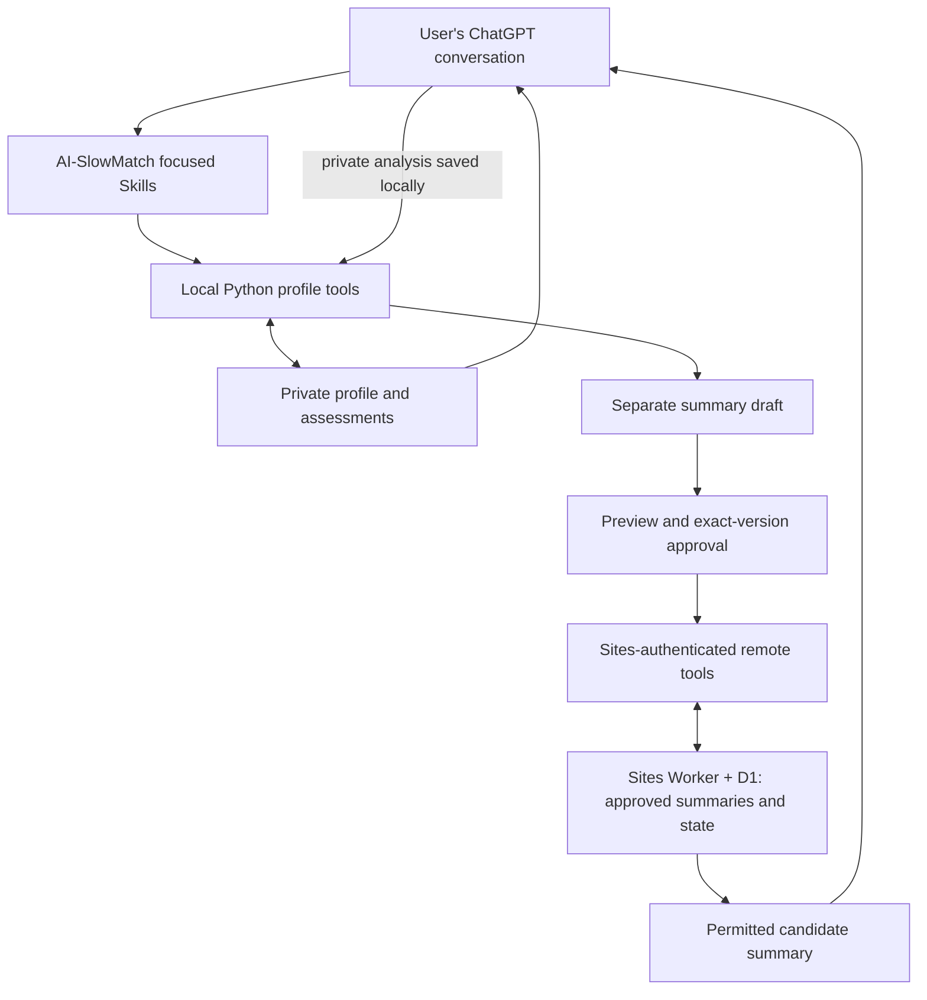

# System Architecture / 系统架构

## English — October 17, 2026

This is the migration architecture, not a completed-deployment claim. The earlier
FastAPI-only scaffold and subsequent GUI-first direction are superseded. Keep this
repository and Python core; use the user's ChatGPT desktop conversation as the
primary interface. The verified 0.5.3 fixed EXE remains for legacy tasks and recovery.
The 0.6.0 source version does not mean that binary has been rebuilt.

Private state reaching ChatGPT is an authorized OpenAI analysis boundary. It does
not pass through Sites. The site has no full-profile upload, local-file reader,
chat-history reader, private-report endpoint or model-provider proxy.

| Layer | Implementation boundary |
|---|---|
| Plugin | `plugins/slowmatch/`: manifest, focused Skills and references. Adapt verified methods with provenance; do not concatenate every prompt or claim a missing Skill exists. |
| Local contracts | `src/anti_dating_scam/models/work_profile.py`: independent versioned Pydantic objects `PrivateProfile`, `ShareableProfileDraft`, `PublishedProfile`, `PrivateMatchAssessment`, and bounded `ShareableSummary`. |
| Local service | `src/anti_dating_scam/services/work_profile.py` reuses guarded I/O from existing review services. Immutable revisions precede atomic head changes; stale updates fail. It does not call a model or upload the vault. |
| Invocation | `src/anti_dating_scam/work_cli.py` is a JSON CLI for a chat with supported local execution. `--help` lists implemented operations. Terminal success alone does not prove desktop Work installation. |
| Hosted service | `apps/matching_site/` uses Sites-supported Workers and D1, not an unchanged Python/FastAPI server. Browser and MCP operations should share business logic. |
| Legacy | Provider interfaces, report/schema tools, PySide6, optional FastAPI and the recovery EXE remain reusable; they do not define a second primary chat product. |

New private state defaults to `%LOCALAPPDATA%/AI-SlowMatch/work`, separated into
`profile/`, `drafts/`, `publications/`, `assessments/` and `outbound/`.
A packaged Windows host may redirect the actual resolved local AppData directory.
Reject Git, OneDrive, build and website directories. State is plaintext unless a
specific artifact explicitly implements encryption; separation is not encryption.

Important private claims retain source type, confirmation and update time.
Self-report, observed facts, model inference and unknown information remain distinct.
Preserve alternatives, corrections and unresolved contradictions. Do not turn a
single emotional event into a permanent label or fill unknowns with founder values.

The summary permits only bounded public labels and selected tokens, coarse location
and reciprocal criteria. A draft is not upload consent. Approval binds content,
version, destination and audience; altered content cannot silently reuse approval.
A local publication receipt starts as approved and is not remotely published until
a service result confirms it. A digest proves equality, not human consent or truth.

Sites dispatch verifies the caller and supplies the Site-scoped
`oai-authenticated-user-id`. Use it for ownership, never a client argument.
Candidate access requires identity, active participation, visibility and reciprocal
hard conditions; omit internal identity credentials. Soft preferences inform
explanations without precision compatibility scores. No invented users or kilometre
claims from city strings. Private explanations use only one's own full profile and
the other's permitted summary, then remain local.

Native Sites MCP declares `"mcp"` in hosting capabilities and exposes stateless
JSON-RPC `/mcp`. Sites manages authentication and connection. Its private
owner-plugin does not prove general distribution. A service bypass token supplies
no participant identity. Website access, browser login, MCP connection and local
Skill installation require separate acceptance evidence.

This repository is authoritative. The hosted source repository required by Sites
is a one-way deployment mirror of `apps/matching_site/`, with the exact source
commit and deployed version recorded. Modify and validate here, synchronize the
selected Site source, and deploy that state; do not maintain independent copies or
change the original Git remote. Runtime data enters neither repository.

`CURRENT_STATUS.md` and `PROGRESS_TRACKER.md` hold current verification. Native
Codex Skill discovery has evidence; desktop Work and two-account hosted use must
not be inferred from it. Retained trust-ladder/report services support decisions;
they do not verify a candidate's character or relationship safety.

## 中文版 — 2026 年 10 月 17 日

这是迁移架构，不是部署完成声明。早期仅 FastAPI 的原型与之后 GUI 优先路线均已被本次要求替代。
继续保留本仓库与 Python 核心，把用户自己的 ChatGPT 桌面对话设为主入口。已验证的 0.5.3
固定 EXE 用于旧功能和恢复；0.6.0 源码版本不表示该二进制已重建。

上图流程为：ChatGPT 对话按需加载 AI-SlowMatch Skills，调用本机 Python 工具读取和更新
私人档案；另行生成摘要草稿，展示并批准具体版本后才交给经过认证的 Sites 工具。Sites 保存批准
摘要和必要状态，返回候选获准摘要。本人 ChatGPT 结合自己的完整档案和候选摘要深入分析，结果留在本机。

私人状态交给 ChatGPT 是经授权的 OpenAI 分析边界，不经过 Sites。网站不提供完整档案上传、
本地文件读取、历史聊天读取、私人报告保存或模型代理接口。

| 层次 | 实现边界 |
|---|---|
| 插件 | `plugins/slowmatch/` 保存 manifest、按需 Skills 和参考。按来源改编实际找到的方法，不拼接所有提示词，不声称已找到缺失 Skill。 |
| 本机结构 | `src/anti_dating_scam/models/work_profile.py` 定义独立版本化 Pydantic 对象：`PrivateProfile`、`ShareableProfileDraft`、`PublishedProfile`、`PrivateMatchAssessment` 与有限 `ShareableSummary`。 |
| 本机服务 | `src/anti_dating_scam/services/work_profile.py` 复用现有报告审阅服务的受保护读写。不可变修订先写入，再原子更新指针；旧版本更新失败。不调用模型或上传资料库。 |
| 调用 | `src/anti_dating_scam/work_cli.py` 为具备受支持本机执行能力的聊天提供 JSON CLI，`--help` 列出实际操作。终端成功不证明桌面 Work 已安装。 |
| 托管服务 | `apps/matching_site/` 使用 Sites 支持的 Worker 与 D1，不原样运行旧 Python/FastAPI 服务。浏览器与 MCP 操作应共用业务逻辑。 |
| 旧功能 | 提供方接口、报告／结构工具、PySide6、可选 FastAPI 和恢复 EXE 继续复用，不形成另一套主聊天产品。 |

新私人状态默认位于 `%LOCALAPPDATA%/AI-SlowMatch/work`，分为 `profile/`、
`drafts/`、`publications/`、`assessments/` 和 `outbound/`。Windows 打包宿主可能重定向
实际解析的本机 AppData 目录。拒绝 Git、OneDrive、构建和网站目录。除特定产物明确实现加密外，
状态为明文；目录隔离不等于加密。

重要判断保留来源类型、本人确认和更新时间，区分自述、可观察事实、模型推断和未知，保留其他解释、
纠正与待澄清矛盾。不把单次情绪固化为永久标签，也不用创始人的答案补全未知。

摘要仅允许有限公开标签与选项、大致地区和双向条件。草稿不等于上传许可；批准绑定内容、版本、
目的地与受众，改变内容后不能悄悄沿用旧批准。本机发布记录初始仅表示已批准，服务端确认后才能标记
远程发布。内容哈希证明相同内容，不证明本人同意或事实真实性。

Sites 平台验证调用者，提供站点范围的 `oai-authenticated-user-id`，所有权使用该身份而非客户端
参数。候选访问需要身份、有效参与、可见范围及双方硬条件；不返回内部身份凭证。软偏好用于解释，
不产生精确兼容分。不虚构用户，不把城市字符串当公里距离。深入分析只结合本人的完整档案与对方获准
摘要，并保存在本机。

Sites 原生 MCP 在托管能力中声明 `"mcp"` 并提供无状态 JSON-RPC `/mcp`。认证与连接由 Sites
管理，所有者私人插件不证明普遍分发能力；服务绕过令牌不提供参与者身份。网页访问、浏览器登录、
MCP 连接和本机 Skill 安装必须分别验收。

本仓库为源码权威。Sites 要求的托管源码仓库仅为 `apps/matching_site/` 的单向部署镜像，记录准确
源码提交和部署版本。先在这里修改与检查，再同步所选站点源码并部署同一状态；不维护独立副本，不更改
原 Git 远端。私人运行数据不进入任何源码仓库。

`CURRENT_STATUS.md` 和 `PROGRESS_TRACKER.md` 记录实时验证。原生 Codex 已有 Skill
发现证据，不能由此推断桌面 Work 或双账号托管使用通过。保留的信任阶梯和报告服务用于决策支持，
不核验候选的人品或关系安全。
