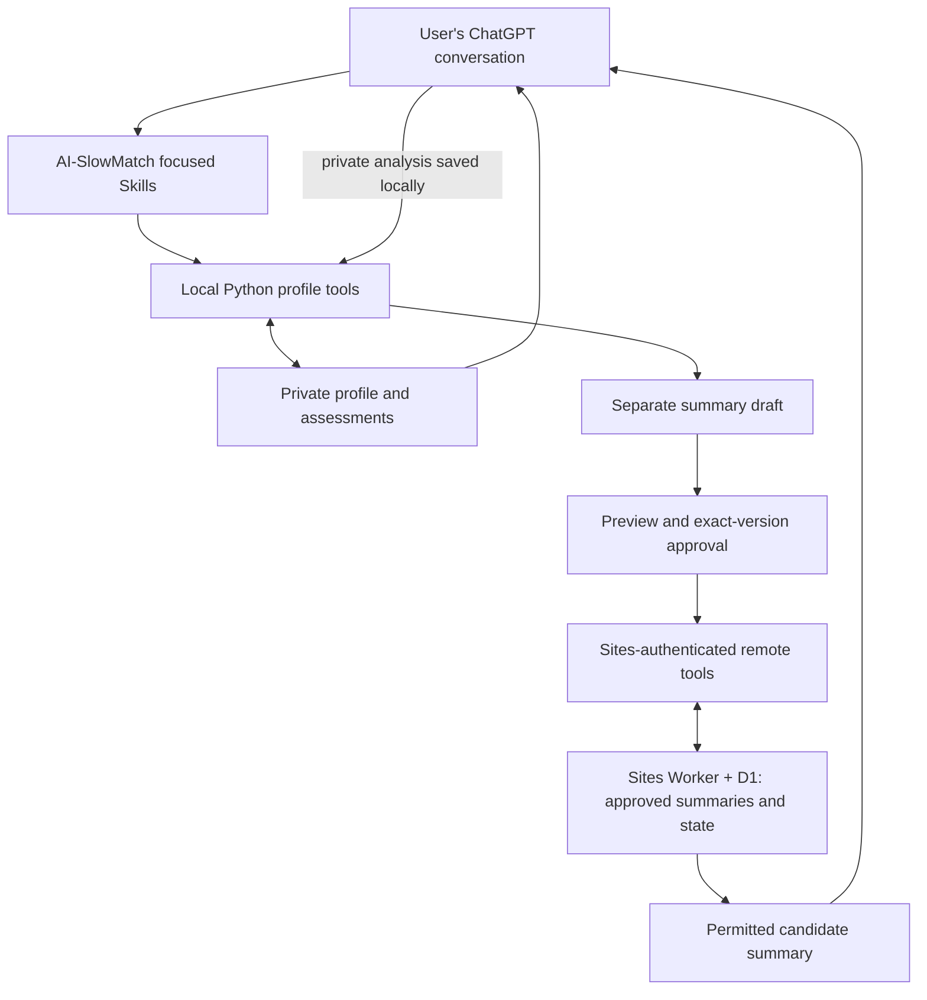

# System Architecture / 系统架构

## English — full replacement architecture

The owner's full October 17 replacement attachment is authoritative. It extends the
single-summary baseline below with independent romance/friendship modes, private
relationship support and consent-bound joint activities/reflection. The baseline is
retained as evidence of prior design; its “summary only” scope now has the narrow
shared-planning exception described here. This is a required architecture contract,
not a claim that every component has been deployed or accepted.

| Responsibility | Required data flow and reuse |
|---|---|
| ChatGPT plugin | The existing `plugins/slowmatch` entry routes progressively to `relationship-support.md`, `reflection.md`, `direction.md`, `profile-tools.md`, `activity-planning.md` and `site-reminder.md`. Cloud analysis stays in the user's authorized ChatGPT workflow; no new main chat client. |
| Local master | Extend `models/work_profile.py` and `services/work_profile.py` through the existing `work_cli.py` launcher. Separate mode participation, corrections, summary approval and private assessment. `models/relationship_support.py` and `services/relationship_support.py` house private observation/material/filter contracts; `models/work_planning.py` houses restricted shared-planning contracts. Actual commands and progress must be read from current code/status. |
| Mode-specific service | Extend the same `apps/matching_site` Worker/D1 service. Ownership comes from verified platform identity. Require both users' active same-mode participation, visibility and reciprocal conditions. Friendship uses shared interests and ways/frequency of spending time together; romantic partner/family requirements do not silently become friendship rules. |
| Shared arrangements | A distinct bounded route reads only each participant's individually approved minimal preferences and current consent. It produces candidate plans, exact-version confirmations and optional individually selected feedback. No full private-profile access or model proxy through Sites. |
| Place discovery | Use available supported web/place lookup, open real sources, and retain source URL/check time/unknowns in plan options. An optional coarse location hint is not GPS or authorization. No mandatory new paid map provider. |
| Private meeting support | Preparation, short user-initiated consultation and private debrief use local/authorized personal context. Text/recollection remains useful without audio. An optional supported audio adapter must implement separate consent and local material lifecycle; the old short Vosk dictation service is a reusable capability, not proof of a meeting recorder. |

Required objects include `PrivateProfile`, per-mode `MatchingParticipation`, draft and
published summary versions, `PrivateMatchAssessment`, `PrivateRelationshipObservation`,
`PrivateInteractionReflection`, selected local materials, `SharedPlanningPreferences`,
`JointPlanningContext`, `MeetingPlan`, optional `SharedMeetingFeedback` and scoped
`ConsentRecord`. Implemented names may use mode-specific persisted summary records for
participation, provided independent state/version/consent semantics are explicit. Do not
mistake the pre-existing generic `models/consent.py` for the new scoped consent contract.

Private data may be supplied to OpenAI for the authorized task; local execution is not
an assurance of zero cloud processing or retention. Sites and peer-facing contexts never
receive private profiles, raw material/audio/transcripts, private analyses or risk reasons,
including hidden fields, embeddings, logs, error payloads and rendered client state.
Shared generation must construct a fresh restricted input from approved objects alone.
A chat already containing private context cannot safely export a generated shared plan
merely because its prompt says “keep secrets.” Use a genuinely isolated supported context
or a deterministic restricted builder; otherwise retain a private draft.

Joint consent binds contributor, content/version, purpose, audience, expiry and revocation.
One participant cannot edit or approve the other's fields. Changed plans invalidate older
confirmations. Only both current confirmations establish a mutually confirmed plan.
Revocation stops subsequent shared reads/generation and clears controlled caches; it does
not undo another person's earlier copy. Plan generation is not permission for invitations,
booking, payment, calendar actions or tracking. Shared feedback never merges private reports.

Render the [approved reminder](../plugins/slowmatch/skills/slowmatch/references/site-reminder.md)
on the homepage explanation, joining, candidate detail and first shared-planning flow.
Match advice distinguishes ordinary mismatch, unknown evidence and concrete behavior concerns.
Personal support never depends on peer consent; no diagnostic/personality/deception score,
forced mediation, background recording or emergency-monitoring promise.

Source authority, protected local state, immutable history, rollback EXE and one-way hosted
source mapping from the baseline remain in force. The twenty replacement acceptance categories
are tracked in `CURRENT_STATUS.md` and `PROGRESS_TRACKER.md`; independent accounts, actual
network receipts, physical audio, place evidence and UI visibility must be distinguished
from synthetic unit/build success. Preserve verified prior evidence; test new remaining risks.

## 中文版 — 完整替代架构

所有者 10 月 17 日完整替代附件为最新权威。在下方单摘要基线上增加独立恋爱／朋友模式、私人关系
支持以及带授权的共同活动／复盘。基线保留此前设计证据，其中“只存摘要”的范围新增下述狭窄共享安排
例外。本节是必须实现的架构约束，不声称每个组件已经部署或验收。

| 职责 | 必需资料流与复用 |
|---|---|
| ChatGPT 插件 | 现有 `plugins/slowmatch` 入口按需读取 `relationship-support.md`、`reflection.md`、`direction.md`、`profile-tools.md`、`activity-planning.md` 和 `site-reminder.md`。云端分析仍在本人授权的 ChatGPT 工作流，不另造主聊天客户端。 |
| 本机主存 | 通过现有 `work_cli.py` 启动器扩展 `models/work_profile.py` 与 `services/work_profile.py`，分离模式参与、纠正、摘要批准和私人分析。`models/relationship_support.py`／`services/relationship_support.py` 承担私人观察／材料／筛选结构，`models/work_planning.py` 承担受限共同安排结构。实际命令与进度以当前代码／状态为准。 |
| 分模式服务 | 扩展同一个 `apps/matching_site` Worker/D1。所有权来自平台验证身份，双方同模式参与、可见性及双向条件都要满足。朋友使用共同兴趣、相处方式／频率，不暗中套用择偶／家庭条件。 |
| 共同安排 | 独立有界路径只读各自批准的最小偏好及有效授权，产生候选计划、具体版本确认和可选选定反馈；不读取完整私密档案，不让 Sites 成为模型代理。 |
| 地点发现 | 用实际受支持的网页／地点检索并打开真实来源，在方案中保留 URL／核对时间／未知。可选大致位置提示不是 GPS 或授权，不强制增加付费地图提供方。 |
| 私人见面支持 | 准备、本人主动中途咨询和私人复盘使用本机／获准个人上下文。无音频时文字／回忆仍可用。可选受支持音频适配器须实现独立许可及本机材料生命周期；旧短 Vosk 听写是可复用能力，不证明已有完整见面录音器。 |

必需对象包括 `PrivateProfile`、分模式 `MatchingParticipation`、草稿和已发布摘要版本、
`PrivateMatchAssessment`、`PrivateRelationshipObservation`、`PrivateInteractionReflection`、
选定本机材料、`SharedPlanningPreferences`、`JointPlanningContext`、`MeetingPlan`、可选
`SharedMeetingFeedback` 与限定范围的 `ConsentRecord`。实现可用分模式持久化摘要记录表示参与，
但状态／版本／授权语义必须独立明确。旧 `models/consent.py` 的通用结构不等于新的限定用途授权。

私人内容可按授权供 OpenAI 分析，本机执行不保证零云端处理或保留。Sites 和对方可见上下文不得获取
完整档案、原始材料／音频／转写、私人分析或风险原因，包括隐藏字段、向量、日志、错误及前端状态。
共同生成必须仅从获准对象构建新的受限输入。含私人上下文的聊天不能仅凭“保密”提示就导出生成计划。
使用真正隔离且受支持的上下文或受限确定性构建器，否则只保留私人草案。

共同授权绑定贡献者、内容／版本、用途、受众、到期和撤回。一人不能替另一人修改或批准字段，计划变化
使旧确认失效；双方都确认当前版本才算共同确认。撤回停止后续共享读取／生成并清除受控缓存，不会收回
别人以前保存的副本。生成计划不授权邀请、预订、付款、日历动作或跟踪，共同反馈不合并私人报告。

[获准提醒](../plugins/slowmatch/skills/slowmatch/references/site-reminder.md)须在首页相关解释、加入、
候选详情和首次共同安排实际显示。建议区分普通不合适、材料未知和具体行为风险。私人帮助不依赖对方
许可；不作诊断／人格／欺骗打分，不强迫调解，不后台录音，不承诺紧急监控。

基线中的源码权威、受保护本机状态、不可变历史、恢复 EXE 和单向托管源码映射继续有效。二十类新验收
在 `CURRENT_STATUS.md`／`PROGRESS_TRACKER.md` 记录；独立账号、真实网络回执、实体音频、地点
证据和 UI 可见必须与合成单元／构建成功分开。保留已验证证据，只测新增剩余风险。

## Capability evidence / 能力证据（October 17 replacement audit）

| Capability / 能力 | Observed support and limit / 已观察支持与限制 |
|---|---|
| Local/cloud / 本机与云端 | [Official local-security documentation](https://learn.chatgpt.com/docs/enterprise/chatgpt-work-local-security) says local execution can send relevant context to OpenAI; availability and approvals remain capability-specific. 本机执行可把相关上下文交 OpenAI，各项可用性及审批独立，不能承诺云端零保留。 |
| Location and files / 位置与文件 | [Plugin reference](https://developers.openai.com/plugins/reference) documents optional coarse `openai/userLocation` hints and UI file selection. This is not GPS, authorization or proof the current plugin has those APIs. 文档存在可选大致位置提示和 UI 文件选择，不等于 GPS、授权或当前插件已可调用。 |
| Place evidence / 地点证据 | [Web search](https://learn.chatgpt.com/docs/web-search) exists in this tool inventory and successfully retrieved official pages. Real venue recommendations must separately open actual place/event sources; this audit did not establish GPS or a map provider. 当前工具有网页检索并实际获取官方页面；具体地点仍须另开真实场所来源，本次不证明 GPS 或地图提供方。 |
| Native voice / 原生语音 | [Voice documentation](https://learn.chatgpt.com/docs/features/voice) describes user-started desktop voice and normal permissions; it does not establish raw meeting-audio export to this plugin. 文档描述用户主动桌面语音和正常权限，不证明插件能导出原始见面音频。 |
| Available audio tools / 可用音频工具 | Current metadata exposes authorized existing Pages meeting transcripts, not a generic local recorder/transcriber. Plugin search found Plaud, Fireflies and Zoom available but uninstalled; no login, capture or private library read occurred. 当前元数据有获准既存 Pages 会议转写读取，不是通用本机录音／转写器；搜索发现三者可安装但未安装，未登录、采集或读取私人库。 |
| Optional API / 可选 API | [Audio transcription reference](https://developers.openai.com/api/reference/resources/audio/subresources/transcriptions/methods/create) specifies audio file input and model-dependent formats/options. Documentation availability does not establish credentials, cost coverage or a tested integration; no API call was made. 文档有音频文件输入及随模型而异的格式／参数，不证明有凭据、费用覆盖或实测接入，未调用该 API。 |

The new local relationship-support service reuses the existing optional Vosk adapter for
explicitly imported short WAVs. Its precise format/size, retention and command boundaries
are in the [reflection reference](../plugins/slowmatch/skills/slowmatch/references/reflection.md).
Source implementation and synthetic unit tests do not prove actual transcription or microphone use.
/ 新本机关系支持服务复用旧可选 Vosk 处理明确导入的短 WAV，具体格式／大小、保留和命令见上述
复盘参考。源码实现或合成单元测试均不证明实际转写或实体麦克风使用。

## e742c0a baseline — English

This is the migration architecture, not a completed-deployment claim. The earlier
FastAPI-only scaffold and subsequent GUI-first direction are superseded. Keep this
repository and Python core; use the user's ChatGPT desktop conversation as the
primary interface. The verified 0.5.3 fixed EXE remains for legacy tasks and recovery.
The 0.6.0 source version does not mean that binary has been rebuilt.

Private state reaching ChatGPT is an authorized OpenAI analysis boundary. It does
not pass through Sites. The site has no full-profile upload, local-file reader,
chat-history reader, private-report endpoint or model-provider proxy.

| Layer | Implementation boundary |
|---|---|
| Plugin | `plugins/slowmatch/`: manifest, focused Skills and references. Adapt verified methods with provenance; do not concatenate every prompt or claim a missing Skill exists. |
| Local contracts | `src/anti_dating_scam/models/work_profile.py`: independent versioned Pydantic objects `PrivateProfile`, `ShareableProfileDraft`, `PublishedProfile`, `PrivateMatchAssessment`, and bounded `ShareableSummary`. |
| Local service | `src/anti_dating_scam/services/work_profile.py` reuses guarded I/O from existing review services. Immutable revisions precede atomic head changes; stale updates fail. It does not call a model or upload the vault. |
| Invocation | `src/anti_dating_scam/work_cli.py` is a JSON CLI for a chat with supported local execution. `--help` lists implemented operations. Terminal success alone does not prove desktop Work installation. |
| Hosted service | `apps/matching_site/` uses Sites-supported Workers and D1, not an unchanged Python/FastAPI server. Browser and MCP operations should share business logic. |
| Legacy | Provider interfaces, report/schema tools, PySide6, optional FastAPI and the recovery EXE remain reusable; they do not define a second primary chat product. |

New private state defaults to `%LOCALAPPDATA%/AI-SlowMatch/work`, separated into
`profile/`, `drafts/`, `publications/`, `assessments/` and `outbound/`.
A packaged Windows host may redirect the actual resolved local AppData directory.
Reject Git, OneDrive, build and website directories. State is plaintext unless a
specific artifact explicitly implements encryption; separation is not encryption.

Important private claims retain source type, confirmation and update time.
Self-report, observed facts, model inference and unknown information remain distinct.
Preserve alternatives, corrections and unresolved contradictions. Do not turn a
single emotional event into a permanent label or fill unknowns with founder values.

The summary permits only bounded public labels and selected tokens, coarse location
and reciprocal criteria. A draft is not upload consent. Approval binds content,
version, destination and audience; altered content cannot silently reuse approval.
A local publication receipt starts as approved and is not remotely published until
a service result confirms it. A digest proves equality, not human consent or truth.

Sites dispatch verifies the caller and supplies the Site-scoped
`oai-authenticated-user-id`. Use it for ownership, never a client argument.
Candidate access requires identity, active participation, visibility and reciprocal
hard conditions; omit internal identity credentials. Soft preferences inform
explanations without precision compatibility scores. No invented users or kilometre
claims from city strings. Private explanations use only one's own full profile and
the other's permitted summary, then remain local.

Native Sites MCP declares `"mcp"` in hosting capabilities and exposes stateless
JSON-RPC `/mcp`. Sites manages authentication and connection. Its private
owner-plugin does not prove general distribution. A service bypass token supplies
no participant identity. Website access, browser login, MCP connection and local
Skill installation require separate acceptance evidence.

This repository is authoritative. The hosted source repository required by Sites
is a one-way deployment mirror of `apps/matching_site/`, with the exact source
commit and deployed version recorded. Modify and validate here, synchronize the
selected Site source, and deploy that state; do not maintain independent copies or
change the original Git remote. Runtime data enters neither repository.

`CURRENT_STATUS.md` and `PROGRESS_TRACKER.md` hold current verification. Native
Codex Skill discovery has evidence; desktop Work and two-account hosted use must
not be inferred from it. Retained trust-ladder/report services support decisions;
they do not verify a candidate's character or relationship safety.

## e742c0a 基线 — 中文版

这是迁移架构，不是部署完成声明。早期仅 FastAPI 的原型与之后 GUI 优先路线均已被本次要求替代。
继续保留本仓库与 Python 核心，把用户自己的 ChatGPT 桌面对话设为主入口。已验证的 0.5.3
固定 EXE 用于旧功能和恢复；0.6.0 源码版本不表示该二进制已重建。

上图流程为：ChatGPT 对话按需加载 AI-SlowMatch Skills，调用本机 Python 工具读取和更新
私人档案；另行生成摘要草稿，展示并批准具体版本后才交给经过认证的 Sites 工具。Sites 保存批准
摘要和必要状态，返回候选获准摘要。本人 ChatGPT 结合自己的完整档案和候选摘要深入分析，结果留在本机。

私人状态交给 ChatGPT 是经授权的 OpenAI 分析边界，不经过 Sites。网站不提供完整档案上传、
本地文件读取、历史聊天读取、私人报告保存或模型代理接口。

| 层次 | 实现边界 |
|---|---|
| 插件 | `plugins/slowmatch/` 保存 manifest、按需 Skills 和参考。按来源改编实际找到的方法，不拼接所有提示词，不声称已找到缺失 Skill。 |
| 本机结构 | `src/anti_dating_scam/models/work_profile.py` 定义独立版本化 Pydantic 对象：`PrivateProfile`、`ShareableProfileDraft`、`PublishedProfile`、`PrivateMatchAssessment` 与有限 `ShareableSummary`。 |
| 本机服务 | `src/anti_dating_scam/services/work_profile.py` 复用现有报告审阅服务的受保护读写。不可变修订先写入，再原子更新指针；旧版本更新失败。不调用模型或上传资料库。 |
| 调用 | `src/anti_dating_scam/work_cli.py` 为具备受支持本机执行能力的聊天提供 JSON CLI，`--help` 列出实际操作。终端成功不证明桌面 Work 已安装。 |
| 托管服务 | `apps/matching_site/` 使用 Sites 支持的 Worker 与 D1，不原样运行旧 Python/FastAPI 服务。浏览器与 MCP 操作应共用业务逻辑。 |
| 旧功能 | 提供方接口、报告／结构工具、PySide6、可选 FastAPI 和恢复 EXE 继续复用，不形成另一套主聊天产品。 |

新私人状态默认位于 `%LOCALAPPDATA%/AI-SlowMatch/work`，分为 `profile/`、
`drafts/`、`publications/`、`assessments/` 和 `outbound/`。Windows 打包宿主可能重定向
实际解析的本机 AppData 目录。拒绝 Git、OneDrive、构建和网站目录。除特定产物明确实现加密外，
状态为明文；目录隔离不等于加密。

重要判断保留来源类型、本人确认和更新时间，区分自述、可观察事实、模型推断和未知，保留其他解释、
纠正与待澄清矛盾。不把单次情绪固化为永久标签，也不用创始人的答案补全未知。

摘要仅允许有限公开标签与选项、大致地区和双向条件。草稿不等于上传许可；批准绑定内容、版本、
目的地与受众，改变内容后不能悄悄沿用旧批准。本机发布记录初始仅表示已批准，服务端确认后才能标记
远程发布。内容哈希证明相同内容，不证明本人同意或事实真实性。

Sites 平台验证调用者，提供站点范围的 `oai-authenticated-user-id`，所有权使用该身份而非客户端
参数。候选访问需要身份、有效参与、可见范围及双方硬条件；不返回内部身份凭证。软偏好用于解释，
不产生精确兼容分。不虚构用户，不把城市字符串当公里距离。深入分析只结合本人的完整档案与对方获准
摘要，并保存在本机。

Sites 原生 MCP 在托管能力中声明 `"mcp"` 并提供无状态 JSON-RPC `/mcp`。认证与连接由 Sites
管理，所有者私人插件不证明普遍分发能力；服务绕过令牌不提供参与者身份。网页访问、浏览器登录、
MCP 连接和本机 Skill 安装必须分别验收。

本仓库为源码权威。Sites 要求的托管源码仓库仅为 `apps/matching_site/` 的单向部署镜像，记录准确
源码提交和部署版本。先在这里修改与检查，再同步所选站点源码并部署同一状态；不维护独立副本，不更改
原 Git 远端。私人运行数据不进入任何源码仓库。

`CURRENT_STATUS.md` 和 `PROGRESS_TRACKER.md` 记录实时验证。原生 Codex 已有 Skill
发现证据，不能由此推断桌面 Work 或双账号托管使用通过。保留的信任阶梯和报告服务用于决策支持，
不核验候选的人品或关系安全。
